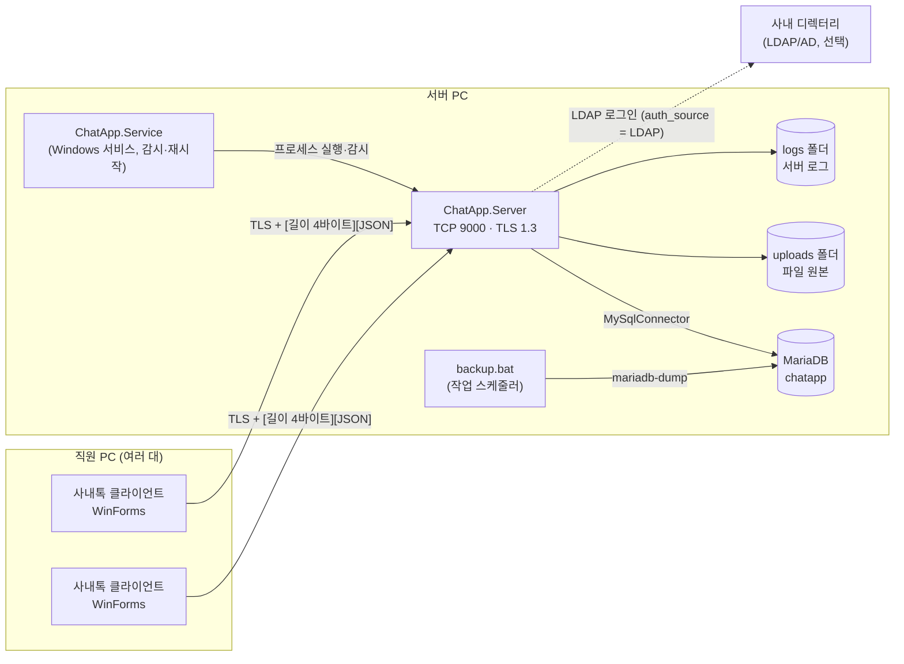
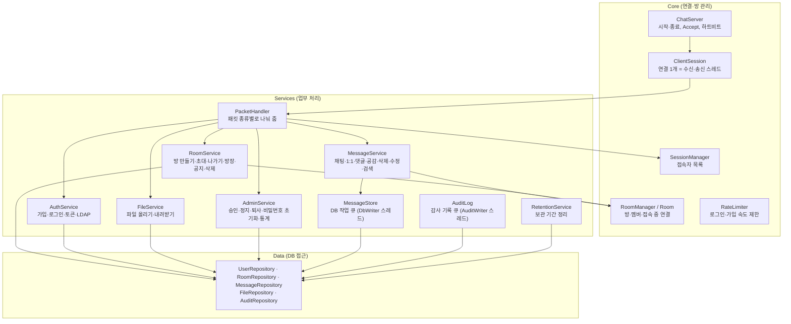
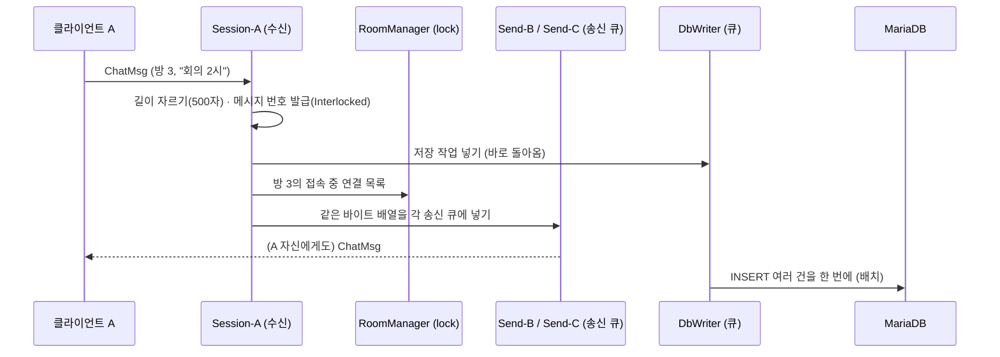
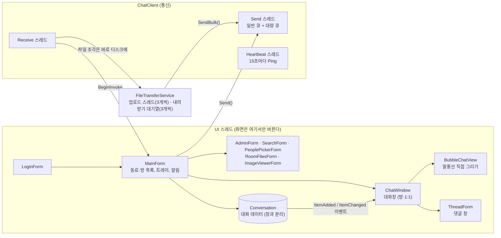
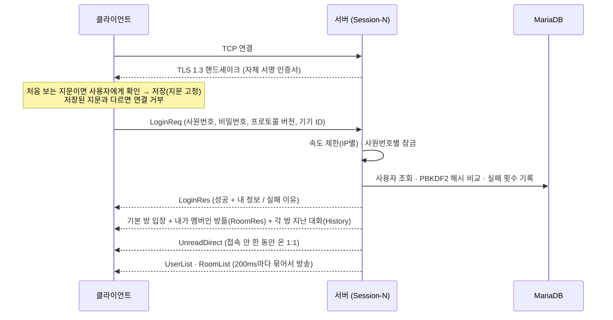
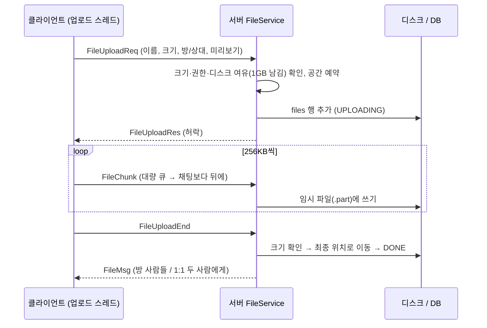
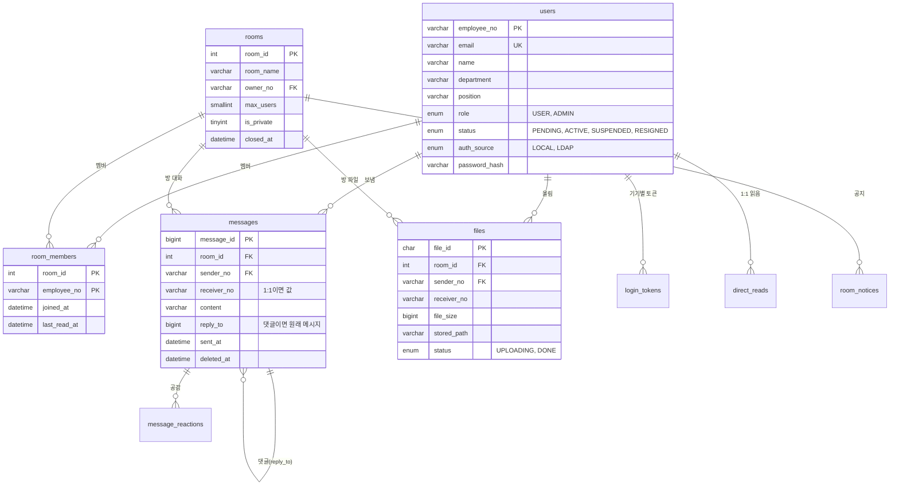

# 아키텍처 문서 — 사내톡 (ChatApp)

| 구분 | 내용 |
| --- | --- |
| 팀명 | 다같이채팅 |
| 팀장 | 박은정 |
| 팀원 | 반재영, 장선화 |

이 문서는 사내톡이 **어떤 부품으로 나뉘어 있고, 스레드가 어떻게 일을 나누며, 데이터가 어디로 흐르는지**를 그림으로 정리한다.
코드의 자세한 설명은 각 파일 맨 위의 `[파일 요약]` 주석에 있다.

---

## 1. 한눈에 보기

C# / .NET 10으로 만든 사내 메신저. 서버 1대에 직원 PC의 WinForms 클라이언트가 TCP(TLS 암호화)로 붙고, 서버만 MariaDB에 접근한다.

| 프로젝트 | 종류 | 역할 |
| --- | --- | --- |
| `ChatApp.Common` | 라이브러리 | 서버·클라이언트가 함께 쓰는 패킷 형식, 직렬화, TLS 도우미, 파일 전송 엔진, 데이터 모델 |
| `ChatApp.Server` | 콘솔 프로그램 | 접속 관리, 채팅방, 메시지 저장, 파일 보관, 관리자 기능, 감사 로그 |
| `ChatApp.Service` | Windows 서비스 | 서버를 PC 시작과 함께 실행하고, 비정상 종료되면 다시 시작 (5초부터 최대 60초 간격) |
| `ChatApp.Client` | WinForms 앱 | 직원이 쓰는 메신저 화면 (로그인, 동료·방 목록, 대화창, 파일, 관리자 창) |
| `ChatApp.ConsoleClient` | 콘솔 프로그램 | 화면 없이 서버를 시험하는 텍스트 클라이언트 |
| `ChatApp.LoadTest` | 콘솔 프로그램 | 가상 사용자 수백 명으로 동시 접속·메시지 유실·지연 측정 |
| `ChatApp.Tests` | xUnit | 단위·통합 테스트 (DB 없이, CI에서 자동 실행) |
| `ChatApp.UiTests` | xUnit + FlaUI | 실제 클라이언트 창을 자동으로 조작하는 화면 테스트 |

---

## 2. 시스템 구성도



- 클라이언트는 **DB에 직접 붙지 않는다.** 모든 요청은 서버를 거치고, 서버가 권한을 확인한다(화면의 버튼 숨김은 편의일 뿐).
- 서버는 파일 원본을 디스크(`uploads/년월/파일ID`)에, 메타 정보는 DB `files` 테이블에 둔다.

---

## 3. 서버 내부 구조



계층 규칙: **Core**는 연결과 메모리 상태만, **Services**는 업무 규칙, **Data**는 SQL만 다룬다. 화면이 없으므로 서버는 리눅스에서도 돈다(테스트·부하 측정은 리눅스 VM에서 했다).

---

## 4. 서버 스레드 모델

| 스레드 | 개수 | 하는 일 | 막히면 안 되는 이유 |
| --- | --- | --- | --- |
| `Accept` | 1 | 새 연결 받기 → 연결 수·IP당 연결 수 확인 → 세션 시작 | 막히면 아무도 새로 접속하지 못한다 |
| `Session-N` (수신) | 접속자마다 1 | TLS 핸드셰이크(10초 제한) → 패킷 읽기 → `PacketHandler` 실행 | 한 사람의 느린 처리가 다른 사람에게 번지지 않게 사람마다 따로 |
| `Send-N` (송신) | 접속자마다 1 | 보낼 패킷 큐(일반 + 대량)를 꺼내 소켓에 쓰기 | 느린 네트워크의 한 사람 때문에 방 전체 방송이 멈추지 않게 |
| `DbWriter` | 1 | 메시지 묶음 저장, 읽음·공감·삭제 기록, 지난 대화 읽기 | 채팅 처리가 DB를 기다리지 않게 (큐에 넣고 바로 돌아감) |
| `AuditWriter` | 1 | 감사 로그 묶음 저장 | 로그인·관리 동작이 기록 때문에 느려지지 않게 |
| `Heartbeat` | 1 | 45초 동안 아무것도 안 온 연결 정리, 1분마다 멈춘 업로드 정리 | 끊긴 연결이 자원을 계속 잡지 않게 |
| `Retention` | 1 | 하루 한 번 보관 기간 지난 대화(365일)·파일(180일)·감사 로그(730일) 삭제 | 큰 DELETE를 나눠서, 낮 시간 부하를 피해서 |
| `Download-…` | 내려받기마다 1 (1인당 최대 3) | 파일을 256KB 조각으로 읽어 대량 큐에 넣기 | 큰 파일 전송이 수신 스레드를 붙잡지 않게 |
| `Logger` | 1 | 로그 파일 쓰기 | 화면·파일 쓰기가 업무 스레드를 막지 않게 |
| `Console` | 1 | 관리자 콘솔 명령 읽기 (`/users`, `/grant` 등) | 입력이 없는 서비스 실행에서도 서버가 멈추지 않게 |



### 동시성 설계 원칙

- **공유 상태는 한 곳에서만 잠근다.** 방 상태는 `RoomManager` 안의 lock 하나, 접속자 목록은 `ConcurrentDictionary`. lock 안에서는 네트워크·DB를 기다리지 않는다.
- **느린 일은 큐로 넘긴다.** DB 저장(`DbWriter`), 감사 기록(`AuditWriter`), 소켓 쓰기(`Send-N`)는 전용 스레드가 큐에서 꺼내 처리한다. 요청한 스레드는 넣고 바로 돌아간다.
- **큐는 무한하지 않다(배압).** 세션 송신 큐는 바이트 용량(기본 64MB)을 넘으면 그 연결을 끊고, 파일 조각은 별도 대량 큐에서 일반 메시지에 밀리며, 지난 대화 요청은 1인당 20개까지만 기다린다.
- **한 번 만든 패킷 바이트는 재사용한다.** 방송할 때 JSON을 받는 사람마다 다시 만들지 않는다 (`Packet.ToWireBytes`). 부하 테스트에서 지연이 458ms → 129ms로 줄었다.
- **예외가 스레드를 죽이지 않게 한다.** 모든 전용 스레드는 바깥에서 예외를 잡아 기록하고 계속 돈다. 처리 중 DB 오류는 그 요청에만 "DB 오류"로 답한다.

---

## 5. 클라이언트 구조



- **화면과 데이터를 나눴다.** 대화 내용은 `Conversation`에 있고 창은 보여 주기만 한다. 창을 닫았다 열어도 대화가 남고, 창이 닫혀 있어도 안 읽은 수가 쌓인다.
- **수신 스레드는 화면을 직접 건드리지 않는다.** 받은 패킷은 `BeginInvoke`로 UI 스레드에 넘긴다. 파일 조각만은 예외로 수신 스레드에서 바로 파일에 써서 UI가 느려지지 않게 한다.
- **보내기는 전용 송신 스레드 하나만 한다.** 채팅(일반 큐)이 파일 조각(대량 큐)보다 항상 먼저 나가서, 3GB 파일을 보내는 중에도 채팅이 바로 간다.
- **자동 재접속:** 끊기면 2→4→8→16→30초 간격으로 다시 연결하고, 저장해 둔 로그인 정보(또는 기기별 자동 로그인 토큰)로 다시 로그인한다. 다른 곳에서 같은 계정으로 로그인해 밀려난 경우(`ForceLogout`)에는 재접속하지 않는다.

---

## 6. 통신 프로토콜

### 6.1 패킷 경계와 형식

TCP는 메시지 경계가 없는 바이트 흐름이라, 모든 패킷을 아래 형식으로 보낸다.

```
[본문 길이 4바이트 (리틀엔디언)][본문: UTF-8 JSON (최대 1MB)]
```

```json
{ "Type": "ChatMsg", "Sender": "홍길동 대리", "SenderId": "A0001", "Target": "3",
  "Body": "회의 2시", "Timestamp": "2026-10-29T01:55:01Z", "MessageId": 1234,
  "ReplyTo": { "MessageId": 1200, "SenderName": "김철수 과장", "Text": "회의 몇 시?" } }
```

- `Type`은 숫자가 아니라 **이름**으로 보낸다. 서버가 더 새 버전이라 모르는 종류가 와도 `Unknown`으로 읽고 무시한다.
- 큰 데이터(목록, 파일 정보)는 `Data`(JSON), 파일 조각은 `Bin`(Base64)에 담는다.
- 길이가 0, 음수, 1MB 초과면 그 연결을 끊는다(메모리 공격 방지).
- 로그인·가입 때 `ProtocolVersion`을 보내고, 서버는 지원하지 않는 옛 버전을 "업데이트하세요"로 거절한다.

### 6.2 주요 패킷 묶음

| 영역 | 패킷 |
| --- | --- |
| 연결·인증 | `ServerInfoReq/ServerInfo`, `RegisterReq/Res`, `LoginReq/Res`, `TokenLoginReq`, `Logout`, `ForceLogout`, `Ping/Pong`, `ChangePasswordReq/Res` |
| 채팅 | `ChatMsg`(방), `Whisper`(1:1), `SystemMsg`, `HistoryReq/History`, `UnreadDirect`, `Typing/TypingUpdate` |
| 메시지 기능 | `MessageDelete/Deleted`, `MessageEditReq/Edited`, `Reaction/ReactionUpdate`, `ReadMark/ReadUpdate`, `SearchReq/Res` (댓글은 `ReplyTo`) |
| 채팅방 | `RoomListReq/RoomList`, `RoomCreate`, `RoomJoin`, `RoomRes`, `RoomInvite`, `RoomLeave/RoomLeft`, `RoomTransferOwner`, `RoomNotice`, `RoomDelete`, `RoomUpdate`, `RoomFilesReq/Res` |
| 사람 | `UserList`(접속자), `DirectoryReq/Directory`(회사 전체), `StatusUpdate` |
| 파일 | `FileUploadReq/Res`, `FileChunk`, `FileUploadEnd`, `FileUploadCancel`, `FileMsg`, `FileDownloadReq/Res`, `FileDownloadEnd`, `FileDownloadCancel` |
| 관리자 | `AdminUserListReq/AdminUserList`, `AdminActionReq/Res`, `AdminAuditReq/AdminAudit`, `AdminStatsReq/AdminStats`, `AdminNotify` |

### 6.3 로그인 흐름



### 6.4 파일 올리기 흐름



---

## 7. 데이터 설계



그 밖에 `message_reactions`(공감), `direct_reads`(1:1 읽음 위치), `room_notices`(방 공지), `login_tokens`(기기별 자동 로그인), `audit_logs`(감사 기록), `schema_version`(DB 버전)이 있다.

- **시각은 UTC로 저장**하고 화면에서 내 PC 시간대로 바꾼다 (`migrate_009`). 지사·출장처럼 시간대가 달라도 순서와 읽음 표시가 맞는다.
- **메시지 번호는 서버가 매긴다.** 시작할 때 DB의 가장 큰 번호를 읽고 `Interlocked`로 1씩 늘린다. 저장 전에 번호가 정해져 있어야 바로 댓글·공감·삭제를 할 수 있다.
- **삭제는 표시만 한다** (`deleted_at`). 감사·분쟁에 대비해 내용은 남기고, 화면에는 "삭제된 메시지입니다."로 보인다.
- **DB 버전 확인:** 서버는 시작할 때 `schema_version`을 보고, 필요한 마이그레이션(`db/migrate_00X`)이 빠져 있으면 실행할 명령을 알려 주고 켜지지 않는다.

| 스크립트 | 내용 |
| --- | --- |
| `schema.sql` | 새로 설치할 때 한 번 (최신 구조 전체) |
| `migrate_002` ~ `005` | 파일, 상태 메시지, 관리자, 영구·비공개 방·답장·공감·읽음 |
| `migrate_006` ~ `010` | 방 공지, 메시지 수정, 자동 로그인 토큰, UTC 시각, 기기별 토큰 |

---

## 8. 보안 설계

| 위협 | 대책 |
| --- | --- |
| 네트워크 엿보기 (비밀번호·대화) | TLS 1.3. 서버가 처음 실행할 때 자체 서명 인증서를 만들고, 클라이언트는 처음 접속할 때 지문을 확인해 저장(TOFU). 이후 지문이 다르면 연결 거부 |
| 비밀번호 유출 | PBKDF2 + 사람마다 다른 salt. 원문은 어디에도 저장·기록하지 않음. 자동 로그인은 비밀번호 대신 기기별 토큰(서버에는 해시만, PC에는 DPAPI로 암호화) |
| 무작위 대입 | 5회 실패 시 10분 잠금, IP별 로그인·가입 속도 제한, 계정이 없어도 같은 시간이 걸리게(가짜 해시) |
| 권한 우회 | 모든 관리·삭제·방장 동작을 서버가 다시 확인. 남의 방·남의 1:1은 검색·답장 인용·파일 받기 모두 불가 |
| 악성 파일 | 파일 이름 정리(경로 조작 차단), 저장은 파일 ID 이름으로. 받은 파일에 "인터넷에서 받음" 표시(SmartScreen 동작), 실행 파일·매크로 문서 열기 전 경고 |
| 자원 고갈 | 연결 수·IP당 연결 수·로그인 제한 시간, 패킷 1MB 제한, 송신 큐 용량 제한, 디스크 여유 확인, 멈춘 업로드 정리 |
| 기록 조작 | 관리 동작·로그인·파일·방 삭제·방장 변경을 감사 로그에 남김(별도 스레드, 지울 수 없음) |

---

## 9. 운영

- **실행:** 개발할 때는 Visual Studio에서 서버·클라이언트를 함께 시작. 실제 서버 PC에서는 `ChatApp.Service`를 Windows 서비스로 등록하면 PC가 켜질 때 자동 실행되고, 서버가 죽으면 5초 뒤 다시 켠다(연달아 죽으면 최대 60초까지 간격을 늘림). 등록·업데이트 방법은 [SERVICE.md](SERVICE.md).
- **배포:** `publish.bat` → 클라이언트 단일 exe + Inno Setup 설치 파일. 서버 설정의 `ClientLatestVersion`을 올리면 옛 버전 사용자에게 업데이트 안내가 뜬다.
- **백업:** `db/backup.bat`(mariadb-dump)을 작업 스케줄러에 매일 등록.
- **로그:** `logs/server-날짜-pid.log`. 서버 콘솔 명령 `/audit`, 관리자 창의 감사 로그·통계 탭.

---

## 10. 테스트 구조

| 단계 | 도구 | 무엇을 |
| --- | --- | --- |
| 단위·통합 | xUnit (`ChatApp.Tests`) | 직렬화, 패킷 경계, 파일 규칙, 보안, TLS, 실제 서버 소켓 |
| 시나리오 | 소켓 테스트 프로그램 + MariaDB | 관리자 흐름, 방·메시지 기능(답장·공감·삭제·읽음·검색·초대·방장·방 삭제), 서버 재시작 후 유지 |
| 화면 자동 | FlaUI (`ChatApp.UiTests`) | 로그인·지문 확인·방 만들기·메시지 주고받기를 실제 창으로 |
| 부하 | `ChatApp.LoadTest` | 100~500명 동시 접속, 유실·순서·지연 |
| 화면 점검 | 점검표 | 나머지 화면 동작 |

자세한 결과는 [TESTING.md](TESTING.md)에 있다.
