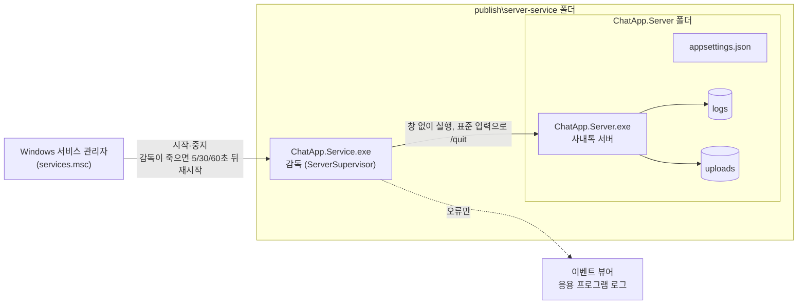

# 서버 운영 가이드 — Windows 서비스로 실행하기

| 구분 | 내용 |
| --- | --- |
| 팀명 | 다같이채팅 |
| 팀장 | 박은정 |
| 팀원 | 반재영, 장선화 |

개발할 때는 Visual Studio에서 서버를 콘솔로 띄우지만, 실제 서버 PC에서는 **Windows 서비스**로 등록해 둔다.
그러면 아무도 로그인하지 않아도 PC가 켜질 때 서버가 시작되고, 서버가 죽으면 저절로 다시 켜진다.

## 1. 구조

| 상황 | 동작 |
| --- | --- |
| PC 부팅 | 자동(지연) 시작 → MariaDB 서비스가 같은 PC에 있으면 그 다음에 시작 |
| 서버가 비정상 종료 | 감독이 다시 켠다. 연달아 죽으면 5 → 10 → 20 → 40 → 60초로 간격을 늘림 (DB가 꺼져 있을 때 무한히 빠르게 재시작하지 않게) |
| 감독(서비스) 자체가 죽음 | Windows가 5초 / 30초 / 60초 뒤 다시 시작. 남아 있던 서버 프로세스는 새 감독이 정리한 뒤 다시 켬 (포트 충돌 방지) |
| 서비스 중지 | 서버에 `/quit` → 아직 저장 못 한 대화와 감사 로그를 저장한 뒤 종료. 20초 안에 안 끝나면 강제 종료 |

## 2. 설치

1. 개발 PC의 솔루션 폴더에서 `publish.bat` 실행 → `publish\server-service` 폴더가 만들어진다.
   (.NET이 없는 PC에서도 돌도록 런타임 포함)
2. 그 폴더를 서버 PC에 통째로 복사한다. 예: `C:\ChatApp\server-service`
3. MariaDB를 설치하고 `ChatApp.Server\db\schema.sql`로 DB를 만든다 (README의 DB 준비 참고).
4. `install-server-service.bat`을 **오른쪽 클릭 → 관리자 권한으로 실행**.
   - 처음이면 `ChatApp.Server\appsettings.json`을 예시에서 만들고 메모장으로 연다 → DB 비밀번호·이메일 도메인을 고치고 저장한 뒤 다시 실행.
   - 서비스 등록(이름 `ChatApp Server`, 표시 이름 `사내톡 서버`) → DB 의존 관계 → 실패 시 재시작 → 방화벽 포트(설정의 `Port`, 기본 9000) 열기 → 시작.
5. 직원 PC 클라이언트에서 서버 주소를 이 PC의 IP로 넣고 접속해 본다.

## 3. 일상 운영

| 하고 싶은 일 | 방법 |
| --- | --- |
| 상태 보기 | `services.msc`에서 "사내톡 서버", 또는 `sc query "ChatApp Server"` |
| 멈추기 / 시작 | `sc stop "ChatApp Server"` / `sc start "ChatApp Server"` (관리자) |
| 서버 로그 | `ChatApp.Server\logs\server-날짜-pid번호.log` (시각은 서버 PC 시간, 예: `14:25:28 +09:00`) |
| 디스크 비우기 | 필요 없는 방을 관리자 창이나 방 메뉴에서 **방 삭제** → 다음 정리(하루 한 번) 때 그 방 파일 원본이 지워진다. 바로 지우려면 서버 콘솔 `/cleanup` (서비스로 돌 때는 서비스를 멈추고 콘솔로 한 번 실행) |
| 저장 위치 바꾸기 | `appsettings.json`의 `"UploadFolder": "D:\\ChatAppUploads"` → 기존 `uploads` 내용을 옮기고 서비스 재시작. 데이터용 드라이브를 쓰는 것을 권장 |
| 서비스 오류 | 이벤트 뷰어 → Windows 로그 → 응용 프로그램 (원본: ChatApp Server) |
| 설정 바꾸기 | `appsettings.json` 수정 → 서비스 다시 시작 |
| 공지·회원 관리 | 서비스로 돌 때는 콘솔이 없으므로 클라이언트의 **관리자 창**을 쓴다 |
| 백업 | `ChatApp.Server\db\backup.bat`을 작업 스케줄러에 매일 등록 |

## 4. 업데이트

1. 새로 `publish.bat` → 새 `publish\server-service` 폴더.
2. 서버 PC에서 `sc stop "ChatApp Server"`.
3. `appsettings.json`, `uploads`, `logs`, `certs` 폴더(서버 인증서)는 **덮어쓰지 않게** 하고 나머지 파일을 덮어쓴다.
   인증서를 지우면 지문이 바뀌어 모든 클라이언트가 "서버 인증서가 바뀌었습니다" 경고를 보게 된다.
4. DB 마이그레이션이 추가되었으면 `db\migrate_0XX.sql` 실행 (서버가 시작할 때 빠진 것을 알려 준다).
5. `sc start "ChatApp Server"`.

## 5. 해제

`uninstall-server-service.bat`을 관리자 권한으로 실행 → 서비스를 정상 종료한 뒤 등록과 방화벽 규칙을 지운다.
프로그램·업로드 파일·로그·DB는 지우지 않는다.

## 6. 문제 해결

| 증상 | 확인할 것 |
| --- | --- |
| 서비스가 "시작 중"에서 멈추거나 계속 재시작 | 서버 로그 맨 아래 오류. 대부분 DB 접속 실패(비밀번호, MariaDB 꺼짐)나 DB 버전 불일치(마이그레이션 필요) |
| 클라이언트가 접속 못 함 | 방화벽 규칙 "사내톡 서버", 서버 PC IP, `Port` 설정 |
| 큰 파일 업로드가 거절됨 (로그: `디스크 공간 부족`) | 업로드 폴더 드라이브의 남은 공간이 1GB 아래. 관리자 창 → 통계 → 디스크 막대로 확인하고 위 "디스크 비우기" |
| "포트 사용 중" | Visual Studio 등에서 띄운 다른 서버가 같은 포트를 쓰는지 확인 (`netstat -ano | findstr :9000`) |
